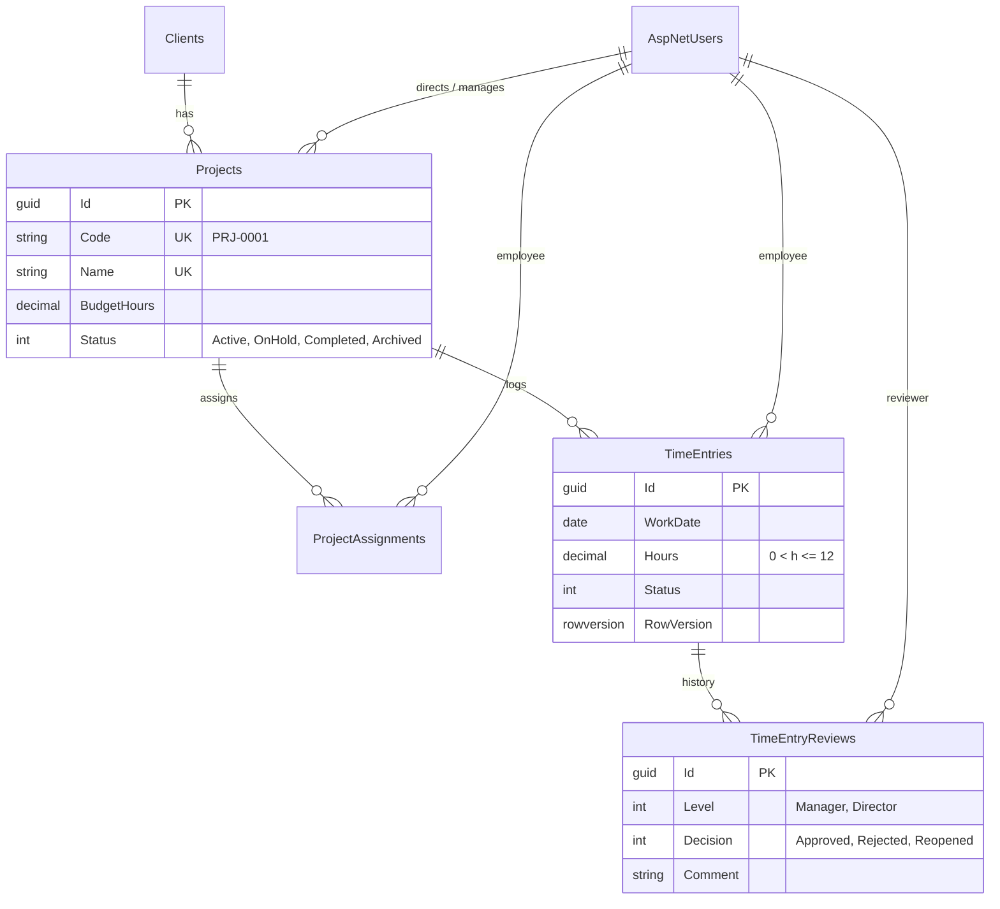
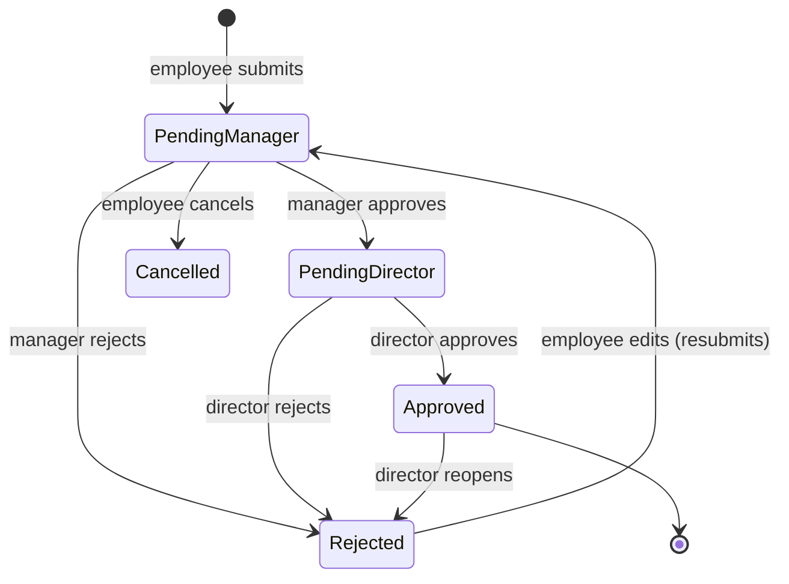

# TimeSheet API

An ASP.NET Core (.NET 10) Web API for logging project hours and approving them in two steps, with budget tracking and reports.

Employees log hours on the projects they are assigned to. A manager approves them first, then a director. Approved hours count against the project's budget. Each role sees its own dashboard and reports.

## Features

- **Three roles plus an admin.** Each role has its own API area (`Employee`, `Manager`, `Director`, `Admin`). Every user has one role. Users outside a project's scope get `404` for it, so the API doesn't reveal that the project exists.
- **Two-step approval.** `PendingManager → PendingDirector → Approved`. Entries can also be rejected (with a comment), cancelled, or reopened by a director. Every decision is kept in a review history.
- **Rules enforced in the service layer and backed by the database:**
  - Employees log hours only on Active projects they are assigned to.
  - One entry per project per day.
  - At most 12 hours per day across all projects.
  - No future dates, and no dates older than 30 days.
  - The budget is locked once the project has its first approved hour.
- **Concurrency safety.** The checks that read other rows (daily cap, duplicate day, project codes and names) run in `SERIALIZABLE` transactions. Time entries have a `RowVersion`, so two reviewers can't both approve the same entry.
- **Budget status** comes from approved hours: `OnTrack` (< 80 %), `NearLimit` (80–100 %), `Exceeded` (> 100 %). A separate `isProjectedToExceed` flag also counts pending hours.
- **Reports:**
  - project summary
  - daily, weekly or monthly balances with opening and closing balance
  - hours per employee
  - a director portfolio with problem projects first
  - PDF export (QuestPDF)
- **Dashboards** per role, and **paging** on every list endpoint.
- **Time-zone aware.** "Today" is the business time zone's date (`Asia/Riyadh`), not server UTC. All limits come from configuration.

## Tech stack

| | |
|---|---|
| Framework | .NET 10, ASP.NET Core Web API |
| Data | EF Core + SQL Server |
| Auth | ASP.NET Identity + JWT bearer |
| Mapping | Mapster |
| PDF | QuestPDF (Community licence) |
| API docs | OpenAPI + Scalar |
| Tests | xUnit, Moq, MockQueryable, FluentAssertions; integration tests on real SQL Server |

## Architecture

Four projects, N-tier:

```
TimeSheet.PL     → controllers per role area, JWT/Identity setup, exception middleware, Program.cs
TimeSheet.BLL    → services (all business rules), DTOs, Mapster config, QuestPDF document
TimeSheet.DAL    → entities, EF configurations, migrations, UnitOfWork + generic repository, seeding
TimeSheet.Tests  → unit tests per service + integration tests against SQL Server
```

- Controllers stay thin. They read the user id from the token and call one service.
- Errors are thrown as `BadRequest` / `NotFound` / `Forbidden` / `Unauthorized` exceptions. The middleware turns them into `{ "success": false, "message": "..." }`.
- Writes that take more than one step run inside a single transaction through `IUnitOfWork.ExecuteInTransactionAsync`.

## Data model



Actual hours are never stored. They are always the sum of the approved entries.

## Approval workflow



## Getting started

**Requirements:** .NET 10 SDK and SQL Server (LocalDB, Express or full).

1. **Set the secrets.** They are kept out of `appsettings.json` and go in user-secrets:

   ```bash
   dotnet user-secrets set "ConnectionStrings:Default" "Server=.;Database=TimeSheet;Trusted_Connection=True;TrustServerCertificate=True" --project TimeSheet.PL
   ```
   ```bash
   dotnet user-secrets set "jwtOptions:SecretKey" "<base64 key, e.g. from: openssl rand -base64 32>" --project TimeSheet.PL
   ```

   In production, use the environment variables `ConnectionStrings__Default` and `jwtOptions__SecretKey` instead.

2. **Run it.** Migrations are applied at startup. In the Development environment, demo users, clients, projects and about 270 time entries are seeded, with dates relative to today.

   ```bash
   dotnet run --project TimeSheet.PL
   ```

3. **Open the API docs** at `http://localhost:5180/scalar/v1`.

### Demo accounts (Development only)

The username is the first name, and each role has one password: `<Role>@1234`.

| Role | Users | Password |
|---|---|---|
| Director | `khaled`, `rania` | `Director@1234` |
| Manager | `omar`, `lina`, `yousef`, `hala`, `tariq` | `Manager@1234` |
| Employee | `ahmad`, `sara`, `mohammad`, `noor`, `faris`, `dana`, `bilal`, `maya`, `zaid`, `reem` | `Employee@1234` |
| Admin | `admin` | `Admin@1234` |

Log in with `POST /api/Identity/Auths/login` and the body `{ "emailOrUserName": "khaled", "password": "Director@1234" }`. Then send the token as `Authorization: Bearer <token>`.

The seeded projects cover every case: on track, near the limit, exceeded, projected to exceed, on hold, completed, archived, reopened and rejected entries, and a manager queue ready for bulk approval.

## API overview

All routes are `api/{area}/{controller}`. List endpoints accept `?page=1&pageSize=20` and return `{ items, page, pageSize, totalCount, totalPages, hasPreviousPage, hasNextPage }`.

| Area | Main endpoints |
|---|---|
| **Employee** | `GET Projects` (dropdown) · `POST/GET TimeEntries` · `PUT/DELETE TimeEntries/{id}` · `GET TimeEntries/{id}/history` · `GET Dashboards` |
| **Manager** | `GET Projects` · `GET TimeEntries/pending` · `POST TimeEntries/{id}/approve \| reject` · `POST TimeEntries/bulk-approve` · `GET Reports/projects/{id}/summary \| daily \| employees \| pdf` · `GET Dashboards` |
| **Director** | `CRUD Clients` · `POST/GET/PUT Projects` · `PATCH Projects/{id}/status` · `POST/DELETE Projects/{id}/employees` · `GET TimeEntries/pending` · `POST TimeEntries/{id}/approve \| reject \| reopen` · `POST TimeEntries/bulk-approve` · `GET Reports/portfolio` · project reports · `GET Dashboards` |
| **Admin** | `CRUD Users` · `PATCH Users/{id}/role \| password \| block \| unblock` |

The full design (entities, every rule, report formulas) is in [`docs/DESIGN.md`](docs/DESIGN.md).

## Configuration

`TimeSheetSettings` in `appsettings.json`. These values are never hard-coded.

```json
"TimeSheetSettings": {
  "BusinessTimeZone": "Asia/Riyadh",
  "WeekStart": "Sunday",
  "MaxDailyHours": 12,
  "MaxBackdateDays": 30
}
```

## Tests

```bash
dotnet test
```

- **Unit tests** cover every service with mocked repositories: every allowed and blocked status change, the daily cap, duplicate days, the budget lock, visibility scoping, report math and paging.
- **Integration tests** (`Category=Integration`) run on a throwaway SQL Server database. It is created and dropped on each run. They cover the full workflow, the race conditions (two submits or approvals at once), and the demo seed itself.
  - They use LocalDB by default. To use another server, set `TIMESHEET_TEST_SQLSERVER` to a connection string without a database name.
  - To skip them: `dotnet test --filter "Category!=Integration"`.

## Database migrations

```bash
dotnet tool restore
```
```bash
dotnet ef migrations add <Name> --project TimeSheet.DAL --startup-project TimeSheet.PL
```
